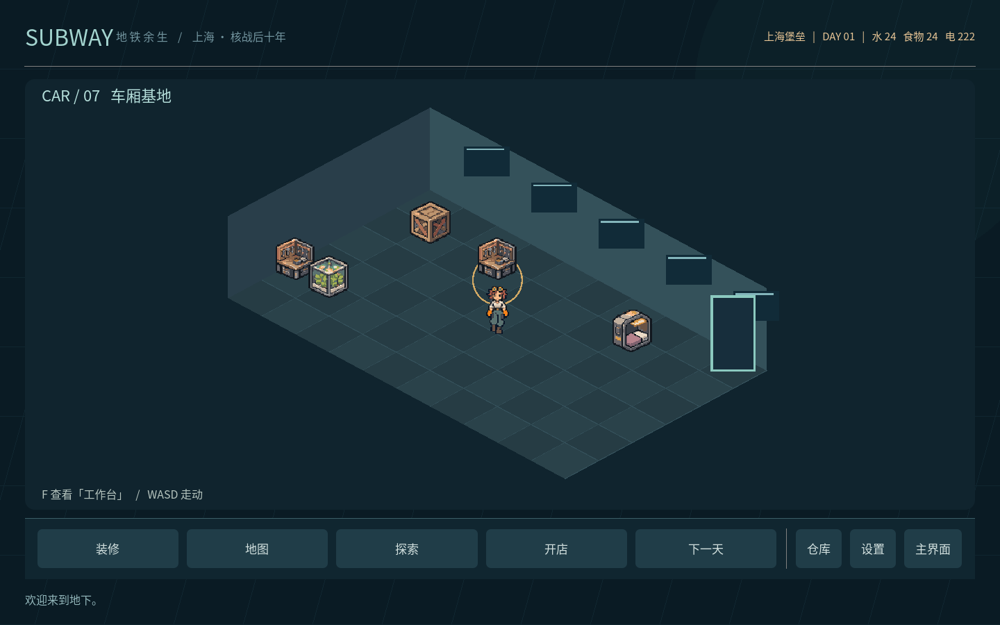
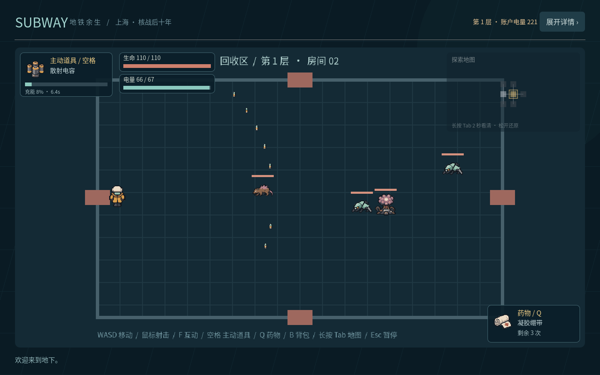
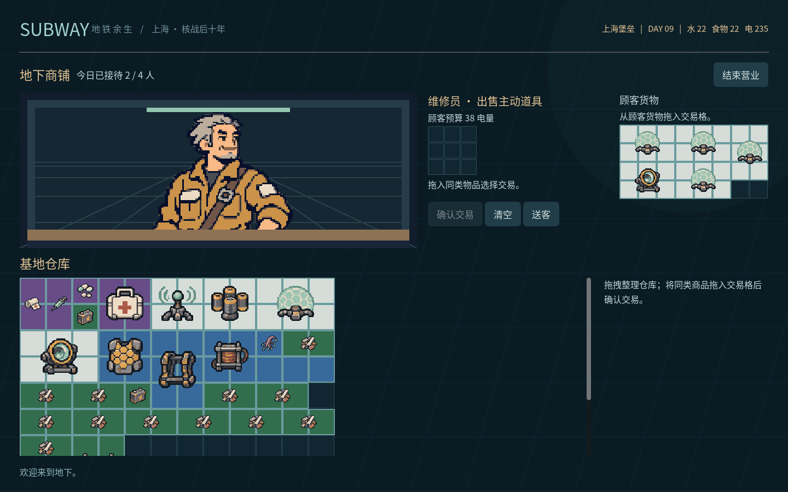

# subway · 地铁余生

当前提交为开发检查点：日耗、复合房间/障碍、扩容背包和独立装备已实现；完整自动试玩与平衡复核仍待完成，见[检查点记录](docs/task-audit.md)。

Godot 4.6 单机游戏原型。核战后的上海，回收员从车厢基地出发，在地表探索，将战利品带回地下市场，再用收入延长下一次作业。



## 运行

1. 安装 **Godot 4.6.x 标准版**，无需 .NET、第三方插件或额外依赖。
2. 克隆仓库，在 Godot 项目管理器中导入 `project.godot`。
3. 按 **F5** 运行项目，选择「开始游戏」，创建任意存档。
4. 在基地底栏选择「探索」；选择职业，将仓库实物拖入装备槽，然后点击「出发」。

命令行也可运行：

```sh
godot --editor --path .
godot --path .
```

项目使用 Compatibility 渲染器，设计分辨率 1440×900，窗口默认最大化，支持全屏。基地使用底部导航，装修为独立页面；基地不再有右侧详情面板。主地图、战斗和商店保留覆盖式详情，不挤压游戏画面。附带 Noto 中文字体，基地可输入中文名称。

任务完成状态、实现证据和验证结果见 [本轮验收清单](docs/task-checklist.md) 与 [复核记录](docs/task-audit.md)。

## 当前可玩内容

| 系统 | 首版行为 |
| --- | --- |
| 主流程 | 主界面 → 三存档 → 基地 → 整备/探索/开店；设置含音量与全屏 |
| 存档 | 三份独立 JSON；默认基地名「上海堡垒」；网格坐标持久化，旧版仓库自动迁移；覆盖前确认 |
| 基地 | 底栏导航与独立装修页；便装少女WASD走动、停步站立，设施前F显示左侧立绘与底部字幕；家具消耗材料合成后放置/移动/回收 |
| 线路图 | 21 条真实线路、110 个主要站点；缩放拖动、筛线选站、路径高亮、悬停信息与移动 |
| 日常 | 探索成功出发、每轮开店各消耗一天（2水、2食物、5电）；整备、交易刷新、窗口切换不重复扣天 |
| 职业 | 坦克8×6、射手8×5、刺客7×4背包；装备独立存放，不占货物格；轻量背架增加一整行 |
| 装备 | 职业使用选项；模块、主动武器、药物从实际仓库格子拖入对应槽，可拖回卸下；出发时扣除实物 |
| 战斗 | WASD 移动；方向键/鼠标射击；四向四帧角色动画；四种小怪与独立 Boss |
| 地图 | 每层36–45房，含两格/三格/L形复合房间；弯折主路线、随机岔路、10种障碍布局；保留原电量预算和11步纵深 |
| 掉落 | 地面显示对应PNG图标；电量/电卡靠近自动吸附；占格物品靠近按F拾取；宝箱按F打开并散落物资 |
| 储物 | 背包、仓库、整备仓库、商店库存统一二维网格；逐物品形状、拖拽与旋转、碰撞和越界检查；战斗时背包锁定 |
| 回收 | 击败Boss后出现两个实体：下层楼梯与返程终端，各自靠近按F；普通房不能撤离；取消整次探索防护倒计时 |
| 经营 | 水、电、食物、药物、武器、模块，各四款；市场买卖、顾客议价成交、跨站价差 |

所有购买及带回的物品先进入仓库，可以择站出售。水、食物、电池也可在「仓库 → 入库使用」转换成基地储备。**交易货币是电量**，战斗移动同样消耗账户电量。初始提供240电量、24水、24食物、所有初版装备各一件，另有12份回收合金、2枚旧式电池和2瓶回收净水用于制作家具。

## 操作

| 操作 | 按键 |
| --- | --- |
| 移动 | WASD |
| 四向射击 | 方向键 |
| 自由瞄准射击 | 鼠标左键 |
| 主动道具 | 空格；左上角显示图标、充能条与剩余充能时间 |
| 使用当前药物 | Q；右下角显示图标和剩余次数 |
| 背包 | B；仅在无敌人时开放 |
| 战斗小地图 | 右上角默认50%不透明度；长按Tab满2秒变100%，松开恢复；只显示已探索及其真实连通邻室 |
| 暂停/关闭弹窗 | Esc |
| 房间移动 | 靠近开放的门按F；Boss清场后靠近楼梯按F下层，靠近返程终端按F返回基地 |
| 地面物资 | 电量/电卡靠近自动吸附；其余物品靠近按F；满背包时保留在原地 |
| 右侧详情 | 仅主地图、战斗、商店保留右上角「展开详情/收起详情」按钮 |
| 基地设施 | WASD走动，靠近设施按F；左侧显示立绘、下方浮动字幕与行动选项 |
| 家具 | 底栏「装修」进入独立页面；「合成」打开配方窗口，选择库存家具放置，拖动移动，右键回收，「完成」返回基地 |
| 储物整理 | 拖动到目标格；拖拽时按R旋转90°，绿色可放、红色表示冲突；选择物品后也可点击旋转 |

每个物品有具体形状，既有1×1、1×2、2×2、3×2长方形，也有L形；主动道具在货物区至少占2×2；拖入右侧装备槽后不占货物格，替换时旧装备需有空间收回。放置同时检查实际占用格、边界和重叠，空格总数够但形状放不下时仍不能拾取。仓库从12×10起步，新增物资放不下时纵向扩展。详情与完整形状表见[格子储物说明](docs/inventory-grid.md)。

药物剩余次数在丢弃后捡回时保留，装备与消耗绑定具体副本。回到基地后，剩余药物作为一件补给存储，下次整备补满次数；此规则为原型简化。

战斗小地图以高亮表示当前房间、浅灰表示已探索、深灰表示与已探索房间存在真实通道的未探索房间，其余房间不显示。长按Tab只改变透明度。地面的电池图标表示直接增加账户和本层电量的拾取物；水瓶、食品和可携带电池商品按各自形状占格，带回仓库后可入库使用。宝箱打开后逐件拾取，无法放入时可以稍后返回。

动物贴图保持直立，仅随实际横向移动左右翻转，纵向移动保留原朝向；枪手撤退时按真实移动方向翻转，停止或被边界阻挡后停止跑步帧。变异鼠持续追击；甲壳兽拥有110基础生命和40%减伤，按待机1.4秒→蓄力0.7秒→长冲刺最多1.8秒→恢复1秒循环，冲刺速度360、每秒最多转向约12.6°，撞墙提前停止。蓄力时显示方向预警线。

子弹贴图按实际速度方向旋转，并以可见轮廓中心定位。敌方子弹显示尺寸28×28（原14×14），碰撞半径6（原3），移速184（原230，降低20%）；友方尺寸14×14、移速540。

## 地图与电量保证

楼层先生成有六次方向变化的主路线，再生长随机分支；角点位置与横/纵镜像提供变化，不再一直向右通关。在相同的x=-5…6、y=-2…2边界内保留36–45个逻辑房间，其中两间占两格、两间占三格，含长条与L形。每个房间有完整占地和真实门口；多格房间实际扩大连续战斗空间，镜头跟随角色，迷雾小地图同步显示形状。

电量预算沿用旧生成器的`2×原房间数+13`，最短主路线保持11次过门。支路与回路必须保留奖励房收束和原预算内至少80%的覆盖路线。10种预存障碍布局由生成器选用，碰撞、子弹阻挡、敌人绕行、甲壳兽撞停和安全掉落均使用同一几何数据。详细逻辑与布局预览见[房间生成说明](docs/floor-generation.md)。

出发与进入下一层仍检查账户足够支付保底预算，每次过门扣1本层电量和1账户电量。普通房不再提供安全返程，击败Boss后可分别与楼梯或返程终端互动；Esc放弃按失败结算。探索防护倒计时已取消，道具充能和短时效果继续使用独立计时。抗辐射片改为恢复20生命并获得8秒护盾。

探索出发与开店会各结算一天；营业仅通过到店顾客买卖，已移除系统商品补货清单；交易与仓库子窗口不重复扣天。资源不足时保留原状态。基地镜头、角色动作、字幕对话及家具配方见[基地系统](docs/base-systems.md)。脱外层防护服仅在结束探索后返基地时播放一次；新建/读取存档、装修、设置或下一天不播放。

## 像素 PNG 素材工作流

已将全部 SVG 美术替换为文生图产生的模拟像素 PNG：保存统一风格提示词 → 为角色/物品描述 → 每个槽位生成 A/B 两个候选 → 视觉识别后使用图像编辑工具修订 B → 技术切片和脚底归一 → Godot 动画与玩法验证。

`assets/art/` 保留提示词、两张候选、编辑后的源图、稳定素材 ID 清单与 109张运行PNG（原80张，加基地四向行走16帧、脱防护服8帧、立绘1张及4位顾客）。角色四向和五类敌人均有四帧动画。`Art.texture(id, frame)` 将美术文件与游戏逻辑分离；替换 PNG、改帧数或重排图集不必改战斗接口。音效仍为原有的四份合成 WAV。

全部运行素材已做区域中值平涂：单张由 428–8352 种近似色减少至 9–26 色，共用 32 色色表，保留原图、透明轮廓和动画锚点。色号与参数可查，详见 [精简算法及前后对比](docs/color-simplification.md)。

完整流程、候选选择理由、再导入命令见 [素材工作流](docs/art-workflow.md)。CI 只切片已审核源图并测试，不重新调用文生图服务。

主地图依据真实上海地铁站序与官方客流资料筛选，原创重绘成 PNG；包含 1–18 号线、浦江线、磁浮线和市域机场线。来源与选站理由保存在 [来源记录](assets/maps/sources.json)，完整带站名参考图为 [上海主地图](assets/maps/shanghai_metro_reference.png)。保留原存档站点索引，旧「虹桥枢纽」「临港避难所」分别对应虹桥火车站、滴水湖。

字体独立采用 SIL OFL，见 `assets/fonts/LICENSE.txt`。代码和原创素材采用 MIT。

## 区域产出与风险回报

素材阶段完成后，已单独加入区域规则：辐射越高，物资丰富度、掉落概率、额外掉落概率、高阶概率和宝箱预算越高；各区域有不同常见物资权重，以及八种严格限定产区的专属材料。其他区域不会产出这些专属物资，带回后可跨站销售。

基础值现覆盖全部 110 个站点对应的 15 个行政地区：14 个地区采用官方资料，黄浦明确标为统计公报转录。缺少统计轴时只按已有指标归一计算，所有在用站点不再使用经济占位值；地区数据不冒称真实单站数据。参数、来源、公式与区域白名单见 [区域数值说明](docs/regional-balance.md)。

## 测试

```sh
# Linux/macOS：脚本会创建隔离的临时用户数据，不触碰正式存档
# 首次准备开发环境（游戏运行不需要 Python）
python3 -m venv .venv
. .venv/bin/activate
python3 -m pip install -r requirements-dev.txt
bash tools/test.sh
```

测试包含1,000个地图种子、固定电量下扩图、原生160组贴图中心、合成/设施对话/奖励与Boss出口、存档/交易/战斗流程、37种物品形状及旋转、碎片空间、真实鼠标拖拽和R旋转、旧档迁移、重复物品、扩容边界、空格充能HUD、动物仅左右翻转、甲壳兽状态/有限追踪/撞墙/真实护甲和场景路由。GitHub Actions每次推送及PR都执行导入与测试。

`tests/capture.gd` 可在有图形显示的环境中生成原生 Godot 截图和区域物资图鉴（使用隔离数据目录和 `SUBWAY_TEST_MODE=1`）；当前截图位于 `docs/`。

## 目录

```text
assets/                 PNG 源图/候选/运行切片、地图、WAV 与字体
scenes/app/main.tscn     应用入口与路由
scenes/frontend/        主菜单、存档、设置、新建存档弹窗
scenes/base/            基地/布置、角色/家具、设施对话/合成与metro主地图
scenes/exploration/     整备、战斗、房间、小地图、HUD、奖励与Boss出口
scenes/inventory/       背包、仓库、网格、装备槽与储物面板
scenes/shop/            商店
scenes/common/          公共弹窗外壳
scripts/main.gd         场景切换、公共样式与共享操作入口
scripts/ui/             各页面控制器、弹窗与公共组件
scripts/game.gd         存档、持久状态、经济与探索状态
scripts/catalog.gd      职业、站点及物品数据
scripts/inventory.gd    形状占位、放置、旋转与容量判断
scripts/floor_generator.gd  随机房间与保底路线
scripts/combat.gd       战斗模拟、敌人、子弹、掉落
scripts/world_view.gd   2.5D 基地和站点图
scripts/minimap.gd      战斗迷雾小地图、Tab长按透明度
scripts/loadout_model.gd  仓库拖拽配装与实物校验
tests/                  地图性质和流程测试、截图脚本
tools/                  素材再生成与隔离测试脚本
docs/                   截图、范围说明与开发记录
```

页面各自拥有场景和控制器，基地/地图/战斗的Stage及嵌套组件也在场景文件中编排；详见[场景分层与职责](docs/scene-architecture.md)。

## 原型边界

本项目提供可以闭环游玩的开发框架，尚未完成平衡与内容量扩展。家具目前全为 1×1 方块，暂无旋转、多格家具或生产功能；区域经济参考与专属掉落已单独实现基础版，数据口径和缺失值说明见下方文档。战斗已支持多格复合房间、10种障碍模板和绕行寻路，尚无破坏掩体、陷阱或完整地表美术关卡。商人和库存为基础模型，尚无完整议价 AI 或日客流上限。

存档按本次请求采用基地操作后自动保存，「下一天」另行扣资源推进；未沿用附件中“存档必定结束当日”的设定。探索仅在返程/失败时结算保存，暂不保存进行中的战斗；强制关闭会回到出发前存档。

附件中的联机、执照、管制品/黑市、污染检查、新闻终端、委托与公共交通等保留为后续设计，详见 [范围说明](docs/design.md)。




### 检查点与完整验收

`bash tools/test.sh --checkpoint`执行已实现功能的源数据与回归验证；只允许`audit-summary.json`明确登记的未完成项，CI会显示完整试玩验收待办，并跳过该验收步骤。生成数据差异、资源缺失、脚本错误、回归和原生渲染仍是失败门禁。

`python3 tools/audit_project.py`及不带参数的`bash tools/test.sh`保持严格完整验收；有未完成项时拒绝通过。清单全部完成后，CI自动恢复完整试玩步骤。阶段检查点的绿色CI不代表游戏整体验收通过。

经营使用独立[顾客窗口](docs/shop-system.md)：按站点限制每日接待量，按类别拖入商品并确认交易，预算随买卖增减；窗口裁切原尺寸立绘，仓库直接显示在下方。

[地铁移动](docs/metro-travel.md)每4段主要站点连线计1天（向上取整），每天消耗2水、2食物、5电量；线路图先显示完整天数和资源费用。
