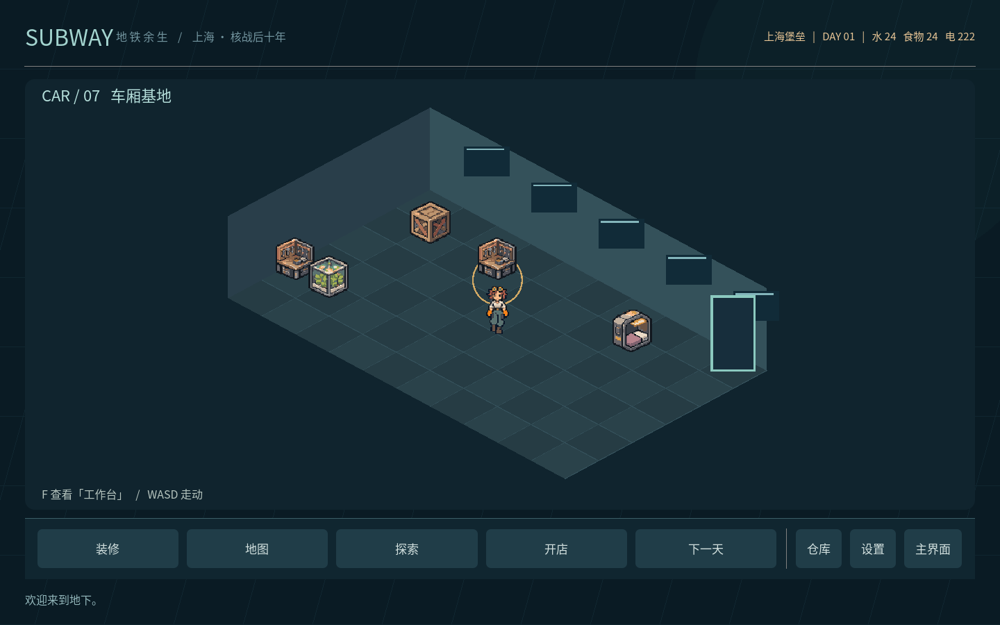
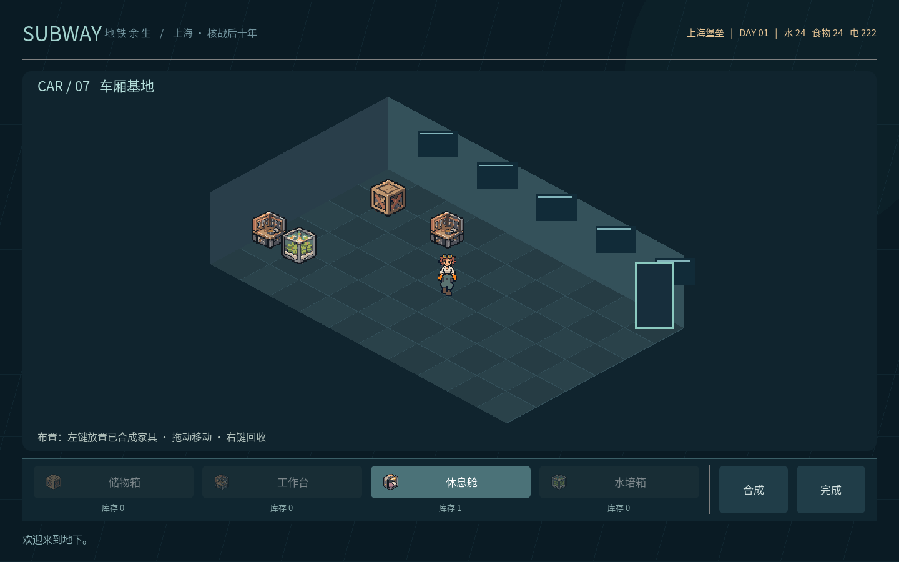

# 基地角色、镜头与家具

基地镜头按车厢实际边界而非整张900×610逻辑画布缩放，优先填满可用高度并保留边距。角色和家具置于按脚底纵坐标排序的独立节点中，支持前后遮挡。

## 活动与日耗

成功出发探索时消耗一天及2水、2食物、5电；整备不消耗，继续同次探索的下一层或返程不重复消耗。装备校验、日常资源和保底电量均通过后，日耗与仓库装备扣除一并保存；任何失败都保留原状态。

开始一轮开店同样消耗一天并刷新日报和顾客。没有系统补货清单；该轮顾客交易、重复绘制商店、设置与仓库子窗口不重复扣天；离开商店返回基地后，再次开店为新的一轮。资源不足时不进入商店。手动「下一天」仍保留相同日耗规则。

## 底栏与装修层级

基地删除右侧展开页和展开按钮，底栏仅保留「装修、地图、探索、开店、下一天、仓库、设置、主界面」行动入口。按钮不携带操作注释、价格或说明后缀；必要的物品属性、配方和价格放在介绍栏。

「装修」挂载独立的`furniture_editor.tscn`及控制器，底栏切换为四种家具、库存数量、「合成」和「完成」，不混入地图/探索/开店等基地选项。无成品的家具不可选；默认选择有库存的成品。合成在装修中的子窗口展示配方，完成后即时更新库存；关闭合成仍留在装修，完成装修才返回基地。Esc也可退出装修。

## 主角与风格

基地使用红发、额头护目镜、白衬衫、宽松工装裤、橙色大手套的少女形象。只有结束探索并返基地（包括救援返程）时，才播放一次8帧脱去外层防护服的动画，全程保留完整内搭。新建/读取存档、设置、装修、切换页面和下一天均不播放。

便装使用四方向各4帧行走；停止移动立即恢复对应方向的收脚站立帧。视觉检查选择现有四方向第2帧作为站姿，无需重新生成素材；碰到边界/家具无法移动或打开对话时也停止行走动画。战斗继续使用防护服角色，主地图不显示便装角色。

保存的描述在`assets/art/prompts/base_heroine.txt`。动画和立绘分别生成A/B两张候选，视觉检查后修订：动画选B并统一手套、像素轮廓与姿势，立绘选A并向原游戏的硬像素风收敛。候选、编辑源图及SHA256记录均保存；运行时经裁切、共用缩放、脚底归一和区域中位数精简。新旧109张PNG使用同一套32色色表，二值透明度、无模糊、无抖动。完整证据见`assets/art/review.json`和`simplification_report.json`。

## 走动与对话

WASD在车厢内移动，角色朝向与行走帧随移动更新，家具会阻挡行走。靠近储物箱、工作台、休息舱、水培箱、内置终端、车窗或气闸门时，底部提示F互动。

查看设施时，主角立绘独立站在画面左侧，看法以半透明底部字幕呈现，相关短标签行动按钮位于字幕下方；使用独立覆盖场景，不套用居中的通用弹窗。例如旧箱子的锁扣、窗外坏天气、蔬菜长势和修旧零件。对话期间暂停基地移动，关闭后继续。终端是车厢内置设施，可进入主地图或装修；气闸门进入探索整备。

## 材料合成

| 家具 | 配方 | 成品在仓库中的形状 |
| --- | --- | --- |
| 储物箱 | 回收合金×2 | 2×2 |
| 工作台 | 回收合金×3、旧式电池×1 | 3×2 |
| 休息舱 | 回收合金×4、凝胶绷带×1 | 2×3 |
| 水培箱 | 回收合金×3、回收净水×1、旧式电池×1 | 2×2 |

合成从真实仓库扣除材料，生成`furn_0`至`furn_3`中的一件成品；材料不足时不消耗、不生成。左键放置时扣除该成品，拖动只改变位置，右键回收将同一家具放回格子仓库。禁止重叠、越界和占用终端/气闸位置；原型中的落地占地仍为1×1。

新档提供12份回收合金、2枚旧式电池、2瓶回收净水，外加原有装备，便于体验制作。旧档不凭空增加材料；已放置家具保留，回收后作为成品入仓。

## 场景与验证

`base/base.tscn`和`base/furniture_editor.tscn`各自拥有页面控制器；`base/heroine.tscn`负责角色动画，`base/furniture.tscn`负责家具显示，`base/dialogue.tscn`和`base/crafting.tscn`分别封装字幕覆盖层与合成。`world_view.gd`管理基地镜头、移动、碰撞和设施选择，地图模式不创建基地角色节点。

`tests/base_combat_revision_checks.gd`和`tests/base_ui_checks.gd`验证配方扣除/失败不变/放置回收/读档、镜头、动画、移动、碰撞与F字幕，以及真实鼠标导航→装修→合成→摆放→完成的层级闭环；原生截图见下图。

