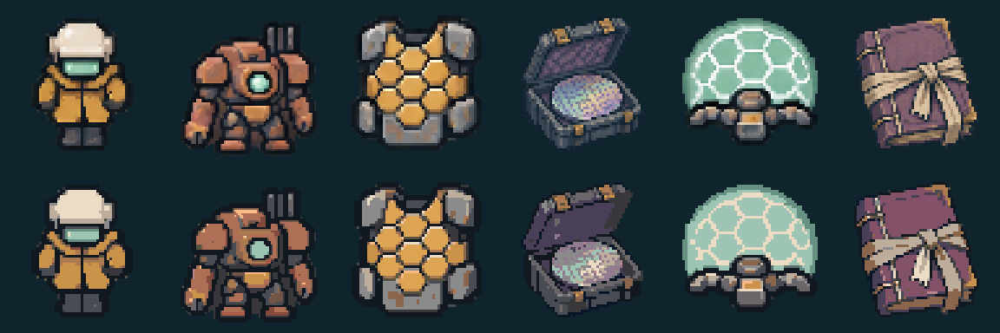

# 颜色精简：区域中值平涂与共享色表

处理对象是 109 张游戏运行 PNG。文生图原图、候选图与编辑后源图保持原样；主地图由确定性色块/线条绘制，原本没有近似色噪点，不做会混淆线路颜色的合并。

## 可重复执行的算法

1. 在每张已切片的 PNG 内，用四邻域建立前景像素的相似色连接。颜色距离使用 CIELAB；默认邻接阈值 ΔE76 ≤ 11.5。
2. 合并时限制组件的 Lab 跨度，避免渐变链把整个人物或不同材质连成一块。默认跨度上限 L=22、a=18、b=18。颜色相近且连续的大块区域因此被归组；明显的深色轮廓、浅色高光与异色设备保持边界。
3. 每个区域按原像素的 RGB 三通道分别取**中位数**，平涂该区域。偶数像素取两个中间值的平均并舍入，不随机选色，不使用模糊或插值。
4. 将相似区域颜色归入共享的 32 个色组。色组代表色按原像素数量加权、逐通道再取中位数；不是 K-means 的平均色。固定初始化与排序，结果可复现。所有角色、敌人、物品和家具共用这套色表，使动画相邻帧也使用统一色号。
5. 原技术导入已去除低 alpha 杂边；此步骤将剩余前景 alpha 统一为 255，背景为 0。保留前景遮罩，不移动像素，不改尺寸和脚底位置。关闭抖动与纹理平滑。

配置：`assets/art/simplification.json`。完整色号：`assets/art/palette.json`，另附 `palette.png` 色卡。逐素材处理统计和前后像素摘要：`simplification_report.json`。

## 本轮结果

109 张素材共用 **32 色**。单张精简前有 **428–8352 色**，精简后为 **9–26 色**；所有前景遮罩与动画脚底基线保留。每个动画组仍有四张不同姿态，未因精简退化为重复帧。



上排为文生图切片，下排为区域中值/共享色表处理后的运行素材。顺序为角色、Boss、蜂巢装甲、晶圆、护盾、历史档案。比较图使用最近邻放大，没有另做锐化。

## 重新导入

Godot 运行游戏不依赖 Python。开发/再生成步骤需要 Pillow；依赖记录在 `requirements-dev.txt`。

```sh
python3 -m venv .venv
. .venv/bin/activate
python3 -m pip install -r requirements-dev.txt
python3 tools/prepare_art_manifest.py
godot --headless --path . --script tools/import_art.gd
python3 tools/simplify_art.py --self-test
python3 tools/simplify_art.py
godot --headless --editor --import --quit
bash tools/test.sh
```

必须先由 `import_art.gd` 从保留的源图重新切片，再做精简；不要反复对已经精简的结果累积处理。`tools/test.sh` 与 GitHub Actions 已串联这一流程。处理前切片仅暂存 `work/art-before-simplification/`，不进入仓库。

单元检查用已知色块验证真正的中位数、权重与材质边界；Godot 检查实际纹理的色号上限、二值透明度、遮罩逐像素一致、帧差异及原图 SHA256 未变，并执行原有玩法回归测试。

未来生成素材时复用 `prompts/style.txt` 和 `prompts/color_lock.txt`，再走候选/编辑/切片/精简/检查流程。更换 PNG 或调色不改变游戏的 `Art.texture(id, frame)` 接口。
