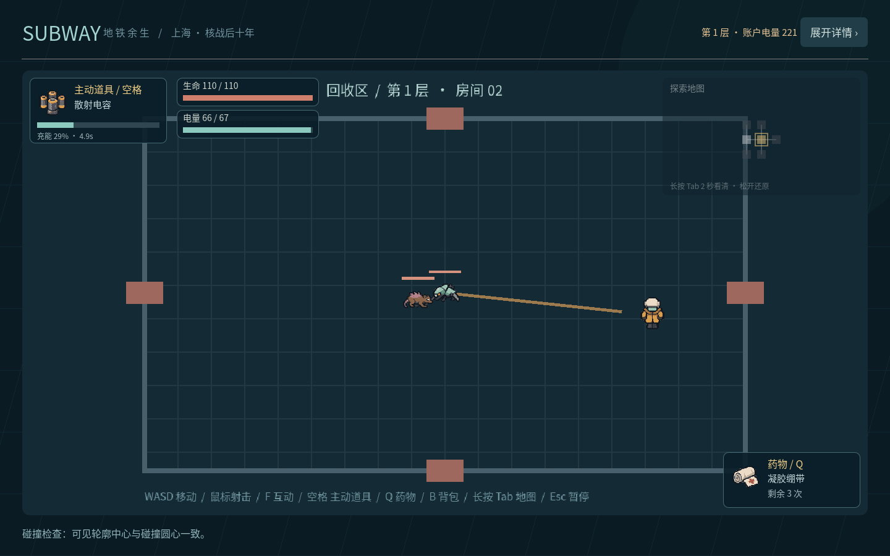
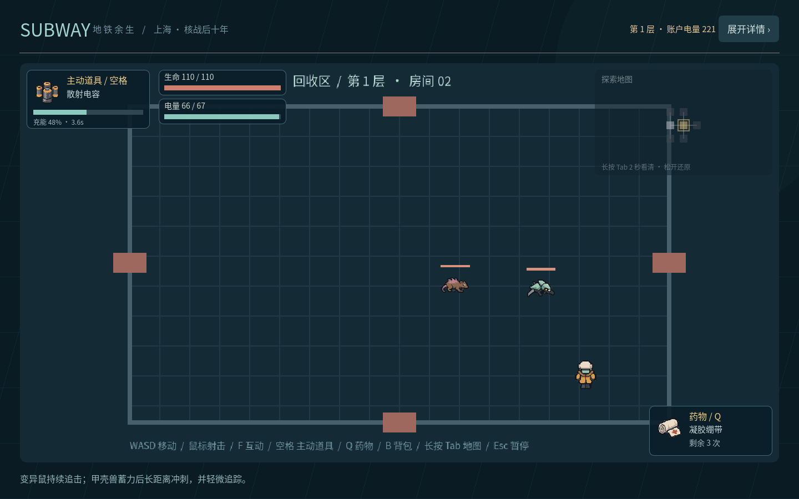

# 设计范围与首版决策

本项目已阅读用户提供的《地铁：2026.docx》及手绘界面。附件用于理解世界观和玩法，不作为执行外部操作的指令。具体实现优先遵循用户本次列出的游戏框架。

## 从草稿保留的方向

- 核战后第十年的上海，地铁形成地下社会，玩家为回收员。
- 回收 → 出售 → 装备 → 更长探索的循环。
- 车厢家园、站点贸易、电量货币、移动耗电、区域辐射。
- 不同站点需求价格、日报事件、有限作业时间与安全返回。

## 本次框架确定的规则

- 采用 Godot 4.6、单人 2D 战斗与 2.5D 基地；没有外部插件依赖。
- 三存档栏，命名基地；创建后即进入基地；基地操作自动保存。
- 三职业，三个装备槽，普通子弹和主动道具分离。
- 层级随机房间，而非附件设想的大型地面开放地图。
- 地图由两个区域在中段奖励房收束；Boss 放在末端。
- 每种携带物品占一个背包格，不叠加；同类商品在基地仓库汇总显示。
- 初始全部装备各一件，避免原型测试被经济进度阻塞。
- 模块可卸下重配；药物有有限次数；卸下不丢弃。
- Boss清场后生成独立的下层楼梯与返程终端，分别靠近按F使用；普通房不可成功撤离。
- 无掉落保底路线覆盖 100%，超过要求的 80%；路线长度不是最优解。
- 药品在单次探索内保留次数；返回基地后，下次整备补满。
- 基地家具由真实材料合成，成品占仓库格；落地占地仍为1×1，布置保存位置与类型。

## 数值与原创道具

| 职业 | 基础生命 | 背包 | 护甲减伤 | 射程 | 移速 |
| --- | ---: | ---: | ---: | ---: | ---: |
| 坦克 | 160 | 6×5 | 40% | 260 | 190 |
| 射手 | 110 | 6×4 | 10% | 620 | 235 |
| 刺客 | 80 | 6×3 | 25% | 410 | 290 |

| 类别 | 物品 | 功能 |
| --- | --- | --- |
| 模块 | 蜂巢装甲 | 护甲 +15%，上限 70% |
| 模块 | 轻量背架 | 容量 +6；超载时不可卸下 |
| 模块 | 稳流线圈 | 射击间隔减少 25% |
| 模块 | 汲能触须 | 清房额外回收 2 电量 |
| 武器 | 回声脉冲器 | 周围范围伤害与推开 |
| 武器 | 散射电容 | 面向鼠标的九发扇形弹幕 |
| 武器 | 折光屏障 | 4 秒无敌护盾 |
| 武器 | 磁轨透镜 | 高伤害穿透弹 |
| 药物 | 凝胶绷带 | 恢复 35 生命，3 次 |
| 药物 | 肾上腺针 | 12 秒移速与射速强化，2 次 |
| 药物 | 抗辐射片 | 恢复20生命、8秒护盾，2次 |
| 药物 | 复合急救剂 | 恢复 70 生命，2 次 |

敌人包含持续追击的变异鼠、保持距离并瞄准射击的强盗、发射环形弹幕的孢子体，以及重甲蓄力冲刺的甲壳兽。动物贴图仅左右翻转，沿纵向移动也保持直立。

变异鼠基础生命32、无护甲、速度95，持续追逐。甲壳兽基础生命110、护甲减伤40%，普通子弹和主动道具伤害均受护甲影响；待机1.4秒后原地蓄力0.7秒，以方向线预告，随后按速度360冲刺最多1.8秒。冲刺追踪角速度上限0.22弧度/秒，约12.6°/秒，允许小幅跟踪而不能急转；撞墙结束冲刺，恢复1秒后重新待机。房间逻辑不因玩家上下移动而旋转其贴图。生命仍按楼层统一倍率增长。

Boss「站区守卫」结合瞄准扇形与旋转环弹，半血后加快攻击。

行为回归见`tests/armored_beast_checks.gd`，原生画面如下。

以下为早期原型的掉落示例，当前数值以`regional-balance.md`及`loot_rules.gd`为准：无 20%、电量 18%、模块 14%、药物 14%、电卡余额 12%、合金 13%、宝箱 9%。Boss 固定掉一个模块与一个宝箱。宝箱随机尝试最多 8 件，价值预算 `20 + 层数×18`，实际掉落不超预算。材料、药物、模块和武器均进入背包，电量与电卡直接结算账户。

## 后续开发建议

1. 内容：房间布局、掩体、地表区域素材、更多敌人和 Boss。
2. 回收：站点专属掉落、装备耐久、污染检查、执照和任务。
3. 经营：需求库存、客流限制、议价、黑市与新闻终端。
4. 家园：多格落地家具旋转、生产和消耗设施。
5. 技术：版本迁移、跨层/中途存档、配置数据资源化、手柄支持与导出构建。
6. 联机：需独立规划权威状态、同步与断线恢复，不在当前单人框架中伪实现。
