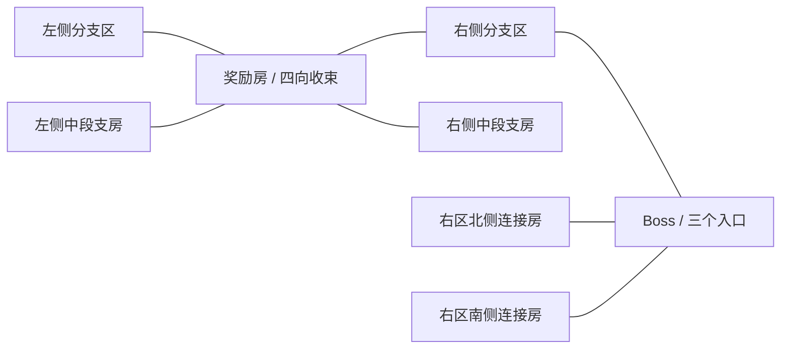

# 战斗地图生成逻辑

本次按用户要求增加房间数量，保留同一种子的原始电量预算和纵深配置。主框架的上海地铁地图不受影响。

| 项目 | 原生成器 | 当前生成器 |
| --- | --- | --- |
| 主干 | x=-5到6，共12格 | 保留；起点到Boss的最短主干仍为11步 |
| 两侧分支 | 每侧随机新增6–9格 | 在原房间基础上补充相邻房间，目标为原数量×1.5，向上取整 |
| 总房间数 | 24–30 | 36–45 |
| 坐标范围 | x=-5…6，y=-2…2 | 保留，不增加纵向跨度 |
| 奖励房 | 位于主干中段，通常两向通行 | 四向连通，仍是左右两区的必经收束点 |
| Boss房 | 主干末端单入口 | 原位置保留，西/北/南三个入口 |
| 电量预算 | 旧保底路线步数+6 | 精确保留同一种子的旧预算，每次过门仍消耗1电 |

## 生成步骤

1. 使用同一种子生成旧地图，取得原房间数`N0`、原位置及电量预算。旧预算等于`2×N0+13`。
2. 保留原主干、起点、奖励房、商店和Boss；补齐奖励房上/下邻居，以及Boss上/下邻居和它们通向右区的连接房。
3. 在相同边界内继续随机向外扩展相邻格，直到房间数达到`ceil(1.5×N0)`。
4. 为同一区域的相邻格建立局部通道。中线旁的支房分别归入左右两区，禁止绕过奖励房跨区，因此地图仍保留葫芦式中段收束。
5. 计算合法的起点到Boss路径，再按“新增覆盖房间数/新增步数”插入支路；使用回路压缩往返，路径始终在旧电量预算内。Boss只在路线末端进入。

空间相邻不等于连通：小地图只显示已探索房间，以及与已探索房间**存在真实通道**的邻居。暗色格不会越过墙壁显示；Tab只改变已知地图的透明度。

## 可复核例子

种子2026：原27房，现41房；主干仍11步；电量仍67。新路线用53次过门遍历41房并到达Boss，未假设任何掉落。

`tests/test_runner.gd`检查1,000个种子：数量倍率、旧电量公式、边界与相邻性、双向通道、奖励房必经、特殊房连通数和预算。当前这1,000个种子均在原预算内覆盖100%房间，超过至少80%的要求。生成器保留`legacy_generate`用于预算校准，不在游戏中显示旧地图。

## 楼层结束

普通房不再提供安全撤离。击败Boss后，房间内出现两个独立实体：左侧下层楼梯与右侧返程终端。分别靠近并按F，直接进入下一层或安全返回基地，不再弹出合并选择窗口。普通房和Boss未击败时均不可用；距离、暂停和按键重复检查分别生效。下一层仍需账户足够支付保底预算，电量不足时留在楼梯旁；Esc中的放弃按失败结算。

整次探索的防护倒计时已删除；动画、敌人攻击节奏、道具充能和短时效果仍使用各自计时。试玩报告的`time_used`仅记录操作耗时，不再决定失败。
