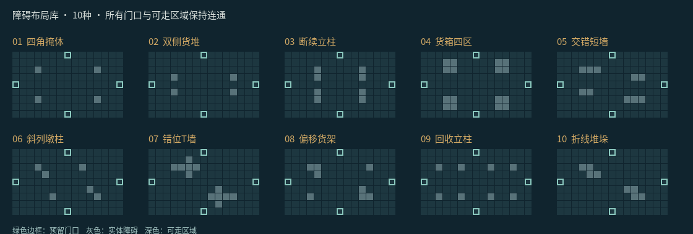
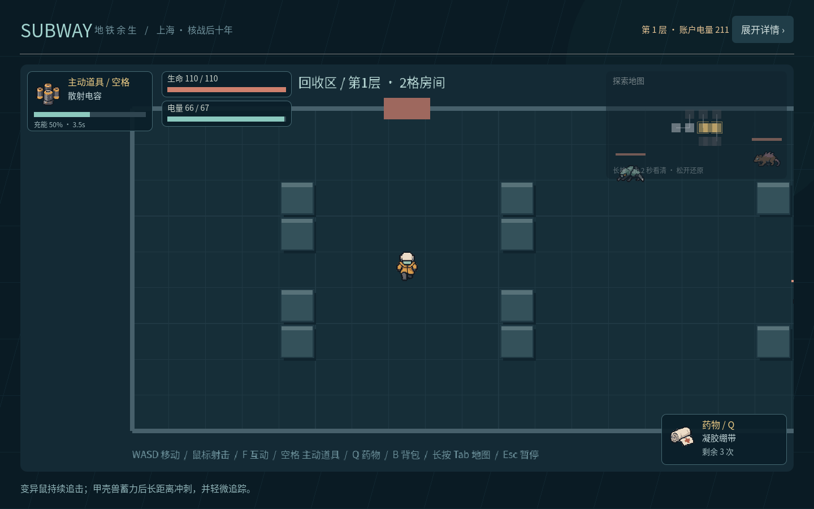
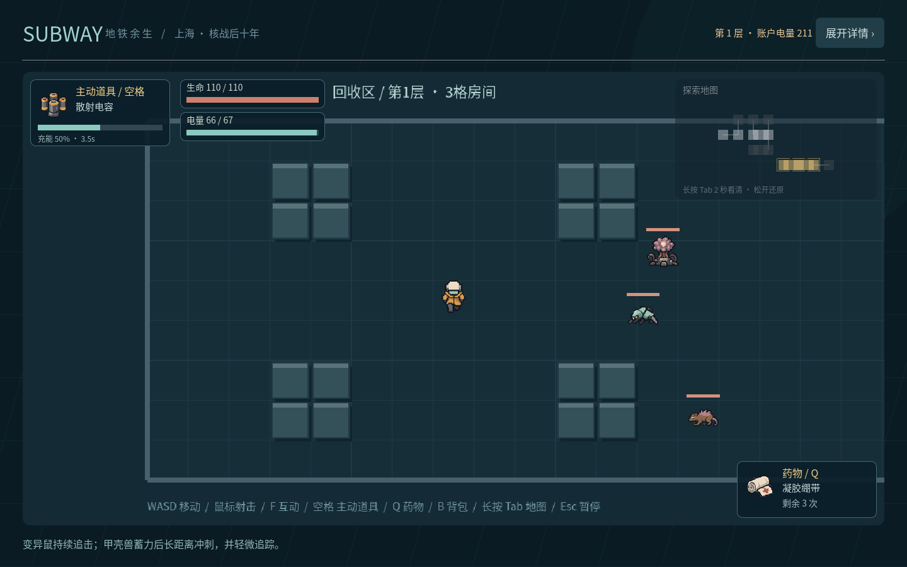
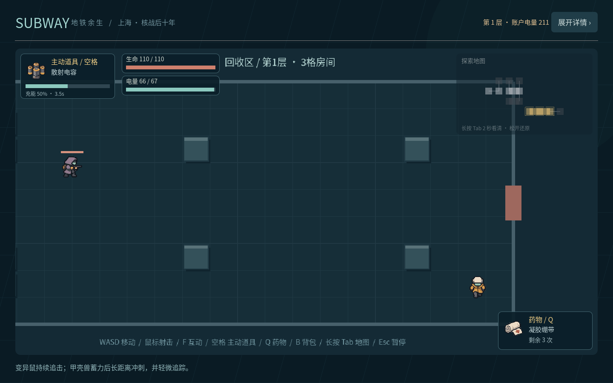

# 战斗地图与障碍布局

本次重做战斗楼层，上海地铁主地图不受影响。楼层有36–45个**逻辑房间**，其中两间占两格、两间占三格；实际共42–51个地图格。大房间是连续扩大的战斗空间，横/纵长条和L形均有独立外墙、门口与镜头跟随，不是把几张普通房图标拼在一起。

## 楼层生成

1. 根据同一种子的旧生成器取得原房数`N0`与电量预算，目标房数仍为`ceil(1.5×N0)`，预算仍为`2×N0+13`。
2. 生成12个单格主路线节点；随机改变三个角点并作横/纵镜像，共32种主路线组合。主路线有六次转向，起点到Boss的最短过门数保持11，坐标边界仍为`x=-5…6、y=-2…2`。起点只有一扇主出口，无法一直向右通关。
3. 中段奖励房连接四个方向；末端Boss房有三个入口。Boss周边的连接支房先接回普通区，因此保底路线可以在进入Boss前访问它们。
4. 逐步向相邻空格生长分支；先插入两间两格房和两间三格房，再补充单格房。尝试整个占地，拒绝越界、重复占格或跨越奖励收束区的形状。
5. 为部分相邻房间加入回路，保留奖励房必经、起点单出口、Boss三入口，以及原11次过门深度。空间相邻不代表一定开门。
6. 为每条实际连接保存一对互逆门口：所属格及朝外方向。多格房间可以在不同墙段有多个门；按F只触发身边的那扇门，进入点位于对方门内侧。
7. 按覆盖收益压缩起点到Boss路线，原预算内至少覆盖80%逻辑房间；不满足时重试。具体采样结果和种子2026例子见[生成验证记录](validation/floor-report.json)。

每次过门扣1电；同一多格房间内部走动不额外扣电。小地图沿用已探索/真实连通邻室规则，当前房间高亮全部占地，内连格共同显示为同一房间；隐藏房间不参与可见边界计算。Tab只改变透明度。

## 十种预存障碍布局

源文件为[layouts.json](../assets/rooms/layouts.json)，每种以15×9网格记录障碍。通过`tools/generate_room_layouts.py`编译为运行资源`room_layout_data.gd`；楼层生成时保存每个占地格的布局ID，进入和重访同一房间不会重新抽取。

四角掩体、双侧货堆、断续立柱、货箱四区、交错短墙、斜列墩柱、错位T墙、偏移货架、回收立柱、折线堆垛，共十种。检查所有可走格连通，边缘通道和四个门口保持可达。普通房随机选用，多格房可组合不同布局；Boss使用稀疏掩体，起始/奖励/商店保留交互空间。

角色和敌人都受实体障碍限制；子弹沿移动线检查碰撞，不能越过掩体。追击怪物使用网格绕行，甲壳兽冲刺撞墙或撞障碍进入恢复。掉落只落在可站立地面。复合房间缺失的L形角落视为墙体，不能走入或射穿。

## 场景验证

`tests/test_runner.gd`检查1,000个种子的房数、占地唯一性、边界、互逆通道、奖励收束、特殊房连接数、曲折主路线、预算和覆盖率。`tests/expansion_checks.gd`检查十种模板的实际可走区域、所有门口、L形内墙、WASD碰撞、子弹阻挡、敌人绕行、冲刺撞停、安全掉落和非网格坐标的拐角接入。

## 楼层结束

只有Boss清场后才显示独立的下层楼梯和返程终端，分别靠近按F使用。下一层检查账户电量，返程保存货物和独立装备；整次探索只在出发时结算一天。整次探索没有防护倒计时，报告中的耗时只记录测试控制器的操作时间。

## 机制参考

参考“先生成楼层拓扑、再选择房间内部模板”的分层方法，以及大房间检查完整占地、按实际出口建立邻接的做法。具体概率和奖励收束为本项目自定。公开机制说明：[BorisTheBrave](https://www.boristhebrave.com/2020/09/12/dungeon-generation-in-binding-of-isaac/)。用户提供的B站视频页未取得可读取正文或字幕，不冒称已观看；来源记录见[sources.json](../assets/rooms/sources.json)。
