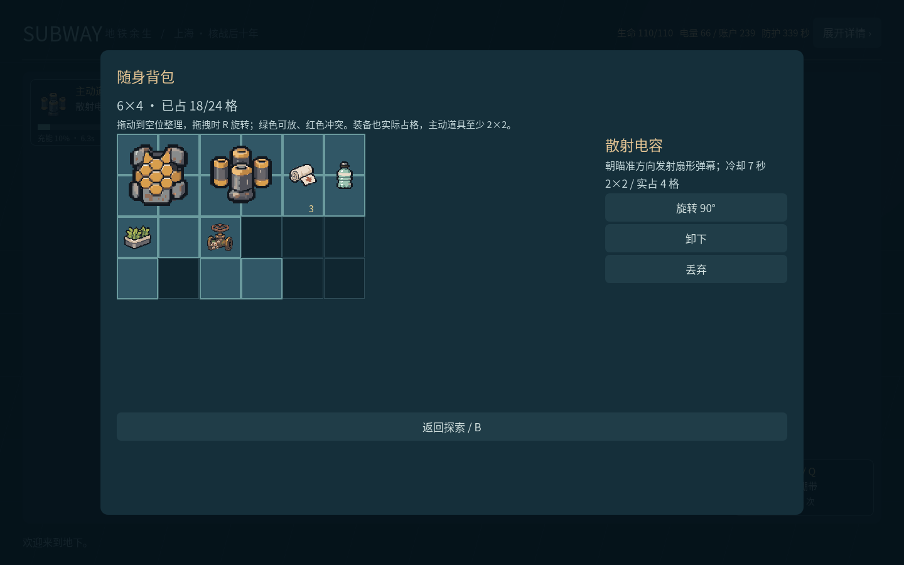
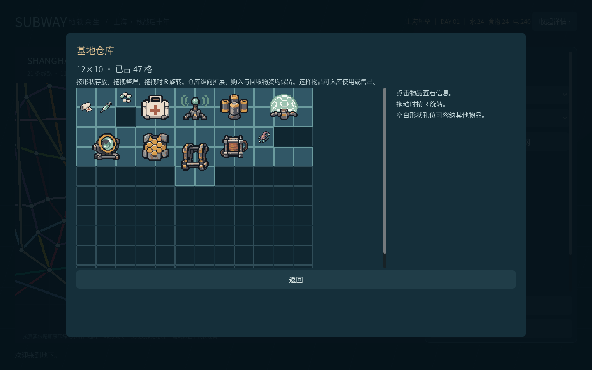

# 格子储物说明

背包、基地仓库、整备仓库和商店柜台库存共用同一套二维网格组件。尺寸按“列×行”显示；每件物品有独立的形状、坐标和旋转状态。新物品自动寻找实际能放下的位置，已有物品由玩家拖拽整理，不按件数抽象计容量。

## 操作与限制

- 左键拖到目标格；拖拽时按R旋转90°，绿色表示可放，红色表示重叠或越界。非法放置和取消拖拽保留原位置。
- 点击物品查看详情；可以用详情中的旋转按钮，或装配、卸下、丢弃、入库使用、出售。物品图标保持正向，格子外形随旋转改变。
- L形的空白孔位不占空间，可以嵌入其他物品。按实际格子判定，因此即使剩余面积足够，碎片空间也可能放不下2×2物品。
- 所有装备仍占背包的实际位置；主动道具至少2×2。战斗中禁止整理和手动拾取，非战斗背包会暂停战斗计时。
- 电量/电卡拾取物仍不占格，靠近自动吸附；水、食品、电池商品、药物、材料与装备按下表形状占格。放不下时留在地上。

| 容器 | 初始尺寸 | 扩展规则 |
| --- | --- | --- |
| 坦克背包 | 6×5，共30格 | 轻量背架增加一行6格 |
| 射手背包 | 6×4，共24格 | 轻量背架增加一行6格 |
| 刺客背包 | 6×3，共18格 | 轻量背架增加一行6格 |
| 基地仓库 | 12×10，共120格 | 新增物资放不下时增加两行，再尝试放置；拖动保留其他物品位置 |

卸下或丢弃轻量背架前，扩展行中的物品必须移回基础范围；系统按坐标检查，不能通过剩余总面积绕过。整备使用实际仓库副本，出发移除选中的那一件；同名副本不会混用位置。探索中的装备和药物消耗绑定副本UID，整理位置不会改变选中的药物。

## 物品形状

`#`为占格，`.`为空白，`/`分隔每行。数据集中在`catalog.gd`的`SHAPES`，供显示、拖拽、拾取、存档验证共同使用。

| ID | 物品 | 外框 | 实占格数 | 形状 |
| --- | --- | --- | --- | --- |
| `0_0` | 回收净水 | 1×2 | 2 | `# / #` |
| `0_1` | 密封饮用水 | 1×2 | 2 | `# / #` |
| `0_2` | 矿化水 | 1×2 | 2 | `# / #` |
| `0_3` | 应急水箱 | 2×2 | 4 | `## / ##` |
| `1_0` | 旧式电池 | 1×1 | 1 | `#` |
| `1_1` | 标准电芯 | 1×2 | 2 | `# / #` |
| `1_2` | 高密电池 | 2×2 | 4 | `## / ##` |
| `1_3` | 固态电池组 | 3×2 | 6 | `### / ###` |
| `2_0` | 压缩饼干 | 2×1 | 2 | `##` |
| `2_1` | 菌菇罐头 | 1×1 | 1 | `#` |
| `2_2` | 水培蔬菜 | 2×2 | 3 | `## / #.` |
| `2_3` | 应急口粮 | 2×2 | 4 | `## / ##` |
| `3_0` | 凝胶绷带 | 1×2 | 2 | `# / #` |
| `3_1` | 肾上腺针 | 1×2 | 2 | `# / #` |
| `3_2` | 抗辐射片 | 1×1 | 1 | `#` |
| `3_3` | 复合急救剂 | 2×2 | 4 | `## / ##` |
| `4_0` | 回声脉冲器 | 2×2 | 4 | `## / ##` |
| `4_1` | 散射电容 | 2×2 | 4 | `## / ##` |
| `4_2` | 折光屏障 | 3×2 | 6 | `### / ###` |
| `4_3` | 磁轨透镜 | 3×2 | 6 | `### / ###` |
| `5_0` | 蜂巢装甲 | 2×2 | 4 | `## / ##` |
| `5_1` | 轻量背架 | 2×3 | 6 | `## / ## / ##` |
| `5_2` | 稳流线圈 | 2×2 | 4 | `## / ##` |
| `5_3` | 汲能触须 | 3×2 | 4 | `#.. / ###` |
| `scrap` | 回收合金 | 2×1 | 2 | `##` |
| `mat_wafer` | 封装半导体晶圆 | 2×2 | 4 | `## / ##` |
| `mat_alloy` | 特种合金锭 | 2×1 | 2 | `##` |
| `mat_culture` | 密封培养试剂 | 1×2 | 2 | `# / #` |
| `mat_watch` | 古董机械怀表 | 1×1 | 1 | `#` |
| `mat_bearing` | 精密涡轮轴承 | 2×2 | 4 | `## / ##` |
| `mat_valve` | 航运阀组件 | 2×2 | 3 | `#. / ##` |
| `mat_seeds` | 耐储种子包 | 2×1 | 2 | `##` |
| `mat_archive` | 修复历史档案 | 2×2 | 4 | `## / ##` |

## 存档兼容

版本2在原有仓库ID列表旁保存`stash_layout`（每件物品的x/y/rot）与`stash_rows`。读取版本1时自动排入网格，保留全部副本；物品多时纵向扩仓。载入时在内存中迁移，下一次正常保存写入版本2。读取版本2时拒绝重叠、越界和非整数坐标，正常保存仍使用临时文件替换。

探索中的药物丢弃/拾回保持剩余次数；返程后作为一件补给保存、下次整备补满次数的既有原型规则保留。

## 验证与截图

`tests/inventory_checks.gd`检查33件物品、旋转、孔位、碎片空间、实际鼠标拖拽/R旋转、扩容卸载、重复副本、旧档迁移、保存往返、空格充能HUD和敌人朝向。`tests/playthrough_audit.gd`按真实几何空间决定是否拾取，并通过空格触发主动道具。

