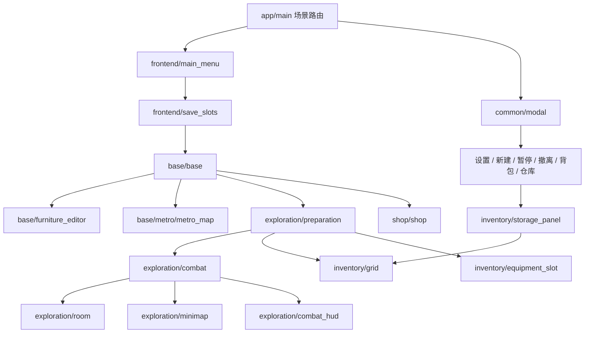

# 场景分层与职责

入口为`scenes/app/main.tscn`。页面场景挂载到入口的内容区；页面脚本负责本页界面、数据展示与交互，入口提供切换、统一样式、提示和公共弹窗入口。原本集中在`main.gd`的菜单、选档、地图详情、整备、战斗面板及商店构建逻辑已迁移到独立控制器。

## 目录

| 层级 | 场景 | 控制器职责 |
| --- | --- | --- |
| 应用 | `app/main.tscn` | `scripts/main.gd`切换页面、公共样式、弹窗生命周期与共享操作入口 |
| 前端 | `frontend/main_menu.tscn`、`save_slots.tscn` | 主菜单、三档创建/读取及命名 |
| 前端弹窗 | `frontend/settings_dialog.tscn`、`new_save_dialog.tscn` | 设置、覆盖前确认 |
| 基地 | `base/base.tscn`、`base_world.tscn` | 基地菜单及2.5D视图，Stage内嵌World实例 |
| 布置 | `base/furniture_editor.tscn`、`furniture.tscn` | 继承基地场景，启用独立的家具布置模式 |
| 主地图 | `base/metro/metro_map.tscn` | 上海线路选择、站点详情、移动；复用World组件的地图模式 |
| 整备 | `exploration/preparation.tscn` | 职业选择、仓库网格、装备槽、实物校验与出发 |
| 战斗 | `exploration/combat.tscn` | 编排Stage内的Room、Minimap与HUD，管理战斗页面菜单与展示 |
| 战斗组件 | `exploration/room.tscn`、`minimap.tscn`、`combat_hud.tscn` | 战斗与通道、已知房间迷雾、主动道具与药物HUD |
| 战斗弹窗 | `exploration/pause_dialog.tscn`、`extract_dialog.tscn`、`reward_dialog.tscn` | 暂停、奖励选择与Boss后的下一层/安全返程 |
| 经营 | `shop/shop.tscn` | 商品目录、顾客交易、格子库存入口 |
| 储物弹窗 | `inventory/backpack_dialog.tscn`、`warehouse_dialog.tscn` | 各自容量说明和操作上下文 |
| 储物组件 | `inventory/storage_panel.tscn`、`grid.tscn`、`equipment_slot.tscn` | 格子显示、拖拽与旋转、物品详情和类型槽 |
| 弹窗外壳 | `common/modal.tscn` | 遮罩、居中框、滚动内容区，层级高于HUD |

共28个场景。页面控制器按相同功能路径放在`scripts/ui/pages/`，弹窗在`scripts/ui/dialogs/`，公共储物组件在`scripts/ui/components/`。基地、主地图、战斗、菜单和储物面板的结构节点写入`.tscn`；动态库存和随机房间内容由脚本填充。

## 数据与生命周期

`Game`自动加载负责存档、交易、仓库与探索状态；`inventory.gd`负责无界面依赖的占位算法；`catalog.gd`集中定义物品形状。网格只提交移动请求，`Game.move_bag`和`Game.move_stash`再次校验边界、重叠与战斗锁定。页面切换不会重新创建存档状态。

入口在`Game.begin_run`成功后才挂载战斗场景，因此嵌套Room在`_ready`中能够读取完整探索状态。关闭弹窗恢复战斗；替换弹窗不会丢失背包位置。页面退场后其子节点一起释放，Room退场时停止音频。单独实例化Room但尚未开始探索时保持停用，页面未接入上下文时也不会执行战斗页面更新。

`main.gd`保留少量转发方法作为菜单信号与流程测试的公共入口；具体页面构建和交互实现放在各场景控制器中。公共组件不反向载入入口场景，避免PackedScene循环依赖。

验证由`tests/test_runner.gd`与`tests/inventory_checks.gd`执行：载入各页面资源、核对独立控制器、走通实际路由、检查布置场景和弹窗/储物组件组合，并覆盖战斗进入、暂停与退出。

基地新增`base/heroine.tscn`、`base/dialogue.tscn`、`base/crafting.tscn`：角色动画由`base_character.gd`负责，家具显示由`base_furniture.gd`负责，立绘对话和合成各自拥有控制器。世界视图管理镜头/走动/设施距离，在地图模式中不创建基地角色节点。敌人绘制共用`enemy_visual.gd`，原生SubViewport回归直接调用同一绘制入口，验证镜像不会引入中心偏移。
